<div align="center">


# Agent Doorbell

**Your VS Code coding agents ring your phone when they need you.**

Approve commands, answer questions, and send prompts from Telegram —
without sitting at the laptop, and without “approve everything”.




<sub>Open the SVG in a browser if GitHub shows a still frame. It loops: laptop → 60s → phone.</sub>

</div>

## The idea in four beats

1. **The agent still asks.** Shell commands, sensitive edits, fetches and questions stay in the Copilot / Claude / Codex prompt — nothing is auto-approved.
2. **Laptop first.** VS Code shows the usual prompt immediately. Your phone stays quiet.
3. **Phone if you're away.** Still unanswered after **60 seconds**? Telegram gets the same request with Allow / Skip buttons and the full command or diff.
4. **First answer wins.** Phone and laptop stay in sync. Answer wherever you are.

You don't babysit, and you don't turn on “approve everything”.

## Why it exists

| Without Agent Doorbell | With Agent Doorbell |
|---|---|
| A five-minute task sits for hours because nobody clicked Allow | The question comes to your phone too |
| “Approve everything” so you can leave the desk | Every Allow is still a human decision |
| No context on the phone | Project, your original ask, and the exact command / diff |
| Phone and laptop can fight | First answer wins; the other side updates |

Telegram bots are free. No public URL, ngrok, or webhook.

## Quick start

Windows, macOS or Linux · Python 3.10+ · VS Code with GitHub Copilot (agent sessions) · Telegram on your phone.

```powershell
git clone https://github.com/PrashantAHD/Agent-Doorbell.git
cd Agent-Doorbell
```

1. In Telegram, open **@BotFather** → `/newbot` → copy the token.
2. Pair: `python bridge.py setup-telegram` (hidden token, then tap **START** on the link).
3. Install:

```powershell
powershell -ExecutionPolicy Bypass -File .\install.ps1   # macOS/Linux: ./install.sh
python bridge.py test-send
```

4. Start a **new** agent session in VS Code (hooks load at session start). After updates, reload the window so the helper extension picks up.

Remove with `uninstall.ps1` / `uninstall.sh`. `config.json` is kept.

> **Codex:** after install, open Codex → `/hooks` and trust the two Agent Doorbell hooks.

## Using it from your phone

| On your phone | What it does |
|---|---|
| **Allow** / **Allow in this session** / **Skip** / **Skip & stop agent** | Answers an approval |
| Type on an approval | Denies it and sends your text as feedback |
| Tap an option, or type | Answers an agent's question |
| Type on a “turn finished” card | Next prompt (`👍 End turn` to leave it) |
| `/sessions` | Pick a VS Code session to prompt |
| `/snooze 2h` · `/pause` · `/resume` | Quiet when you want |
| File + **Allow** | Long command/diff: read the file first |

When several requests are open, type the number first, e.g. `#4 1`.

| Setting (`config.json`) | Default | Meaning |
|---|---|---|
| `push_after_seconds` | `60` | Wait in VS Code before the phone rings |
| `turn_end_after_seconds` | `300` | Wait before a finished turn goes to the phone |
| `quiet_hours` | `""` | e.g. `"23:00-07:00"` |
| `keep_awake` | `true` | Stops idle sleep; screen can still lock |

Re-run the installer after changing settings. Token can also come from `TELEGRAM_BOT_TOKEN`.

## How the pieces fit

| Part | Role |
|---|---|
| [`hook.py`](hook.py) | Copilot / Claude / Codex hooks → local bridge |
| [`bridge.py`](bridge.py) | 127.0.0.1 only, signed requests, Telegram, sync |
| Helper extension | Presses Allow / Skip in VS Code from a phone answer |
| Supervisor | Restarts on crash; starts at login |

## Guardrails worth knowing

- Only your **paired Telegram chat** can answer. Buttons are one-time, tied to that exact prompt.
- Long commands show start **and** end; the full text arrives as a file before Allow.
- “Allow in this session” covers only that exact command, file, site or tool — never sensitive paths or multi-file patches.
- If the helper can't match the waiting prompt, **nothing is pressed**. VS Code remains the fallback.
- Local traffic is HMAC-signed. The bridge does not run arbitrary VS Code commands.

Company machines: check policy before installing a bot that can approve commands. Fail-safe is always the on-screen prompt.

Uses [Spend-Guard](https://github.com/PrashantAHD/spend-guard) in this repo for cheap routine work and an Opus pass on auth, signing and the helper.

## License

[MIT](LICENSE) © 2026 Prashant Kumar

---

<div align="center">
<sub>Agent Doorbell is independent and isn't affiliated with Microsoft, GitHub or Telegram.</sub>
</div>
